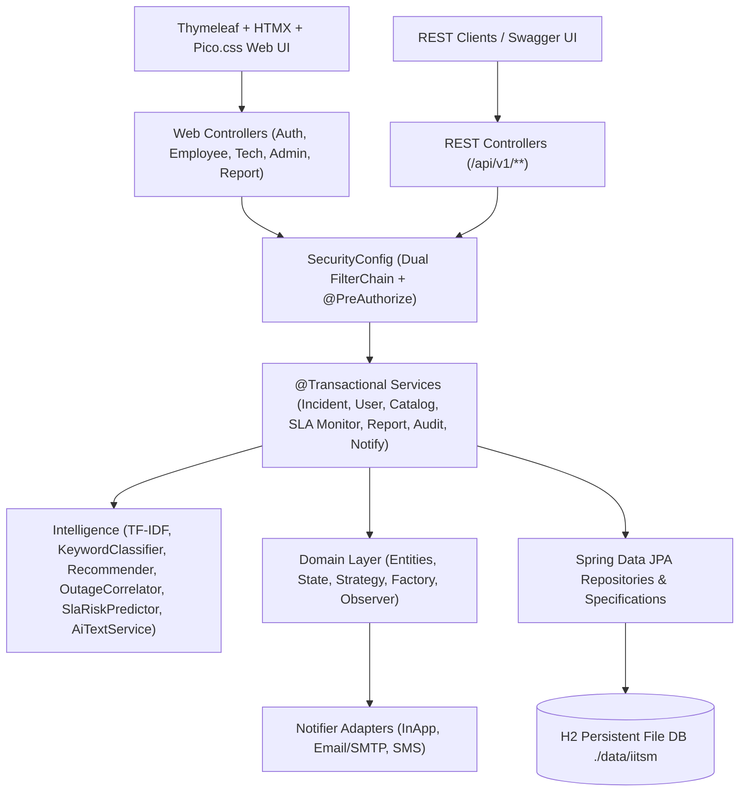

# Architecture

## 1. Layered Architecture
I-ITSM follows strict unidirectional layering: `controller -> service -> domain -> repository`, supported by `intelligence`, `notification`, `exception`, and `config`. Domain classes have zero web dependencies (`jakarta.servlet` / Spring MVC never appear in `domain/`).

## 2. Design Patterns & Justifications
| Pattern | Classes | Architectural Justification |
| --- | --- | --- |
| **State** | `IncidentState`, `IncidentStateFactory`, 9 concrete states | Encapsulates valid transitions per status in an `EnumMap`; illegal moves like `NEW -> CLOSED` throw `InvalidStateTransitionException`. |
| **Strategy** | `PriorityStrategy` (2), `AssignmentStrategy` (5) | Decouples triage scoring and routing algorithms so Admins switch strategies at runtime via `AppSetting`. |
| **Observer** | `IncidentEventPublisher`, `AuditObserver`, `NotificationObserver` | Separates core incident state mutations from immutable auditing and multi-channel alerting. |
| **Factory** | `UserFactory`, `IncidentFactory`, `NotificationFactory`, `NotifierFactory` | Centralizes validated subtype creation, `INC1001+` sequencing, and `ConcurrentHashMap` channel resolution. |
| **Adapter** | `Notifier` (`InAppNotifier`, `EmailNotifier` over `JavaMailSender`, `SmsNotifier`), `AiTextService` (`GeminiAiService`) | Isolates external SMTP and Gemini REST protocols behind domain interfaces with automatic local fallback. |
| **Repository** | 14 Spring Data JPA interfaces + `IncidentSpecifications` | Keeps query/persistence logic decoupled behind clean repository contracts and type-safe `Specification` criteria. |
