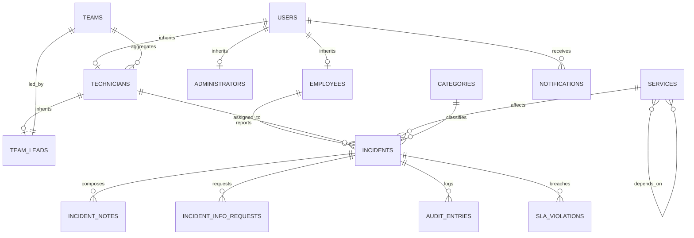

# Database Design

## 1. Entity-Relationship Diagram

## 2. Schema Highlights & Indexes
- **Inheritance (`JOINED`)**: `users` (`id`, `user_code`, `username`, `email`, `role`, `active`), joined by `employees`, `technicians`, `team_leads`, and `administrators`.
- **Core `incidents` table** (PK `id VARCHAR(20)` `INC1001..`): embeds `SlaInfo`, `Resolution`, `Closure`, `Feedback` directly into row columns.
- **Indexes on `incidents`**:
  - `idx_incident_status` (`status`)
  - `idx_incident_priority` (`priority`)
  - `idx_incident_service` (`service_id`)
  - `idx_incident_technician` (`technician_id`)
  - `idx_incident_created` (`created_at`)
- **Additional Constraints**:
  - `sla_violations` has `UNIQUE(incident_id, type)` (`uk_sla_violation_incident_type`) guaranteeing once-per-type breach recording.
  - `audit_entries` has indexes on `incident_id` (`idx_audit_incident`) and `timestamp` (`idx_audit_timestamp`) and `updatable = false` columns.
  - `notifications` has composite index `idx_notif_recipient` (`recipient_user_code, read_flag, created_at`).

## 3. Sample Seed Rows
| Table | Sample Row |
| --- | --- |
| `users` / `employees` | `E101`, `emp1`, `ROLE=EMPLOYEE`, `department='Finance'` |
| `users` / `technicians` | `T101`, `tech1`, `skills=['payment','checkout','application','api']`, `max_load=6` |
| `services` | `Payment` (`criticality=5`), `depends_on=['Database','Network','Authentication']` |
| `sla_policies` | `P1` (`response_mins=5`, `resolution_mins=30`) |
| `incidents` | `INC1001`, `reporter=E101`, `service='Payment'`, `priority=P1`, `priority_score=187.5`, `status='ASSIGNED'` |
| `audit_entries` | `actor='Employee E101'`, `action='CREATED'`, `incident_id='INC1001'`, `new_state='NEW'` |
