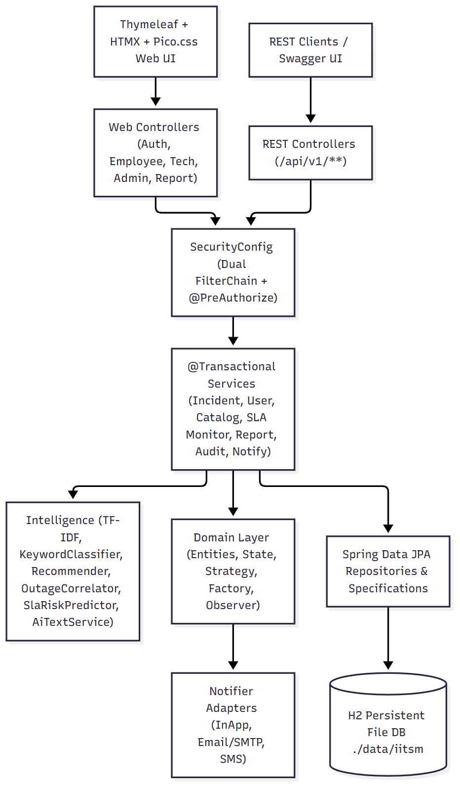
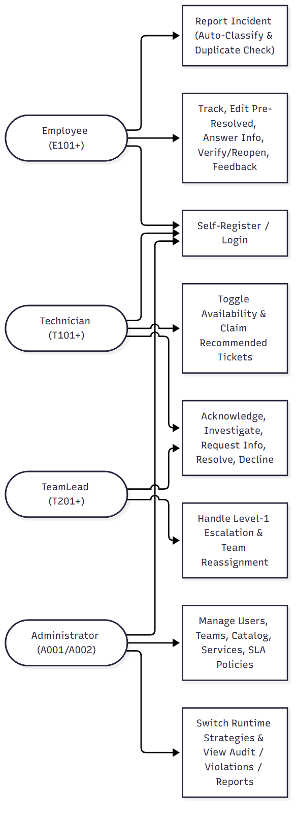
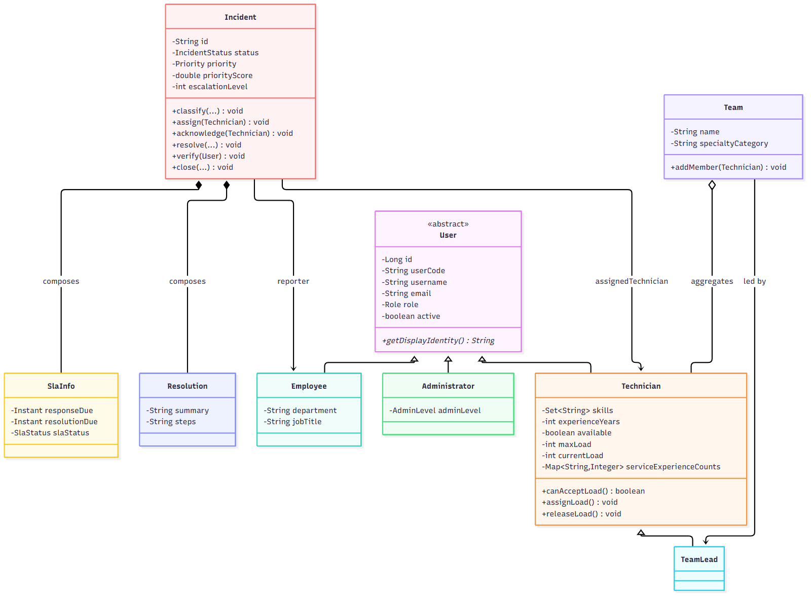
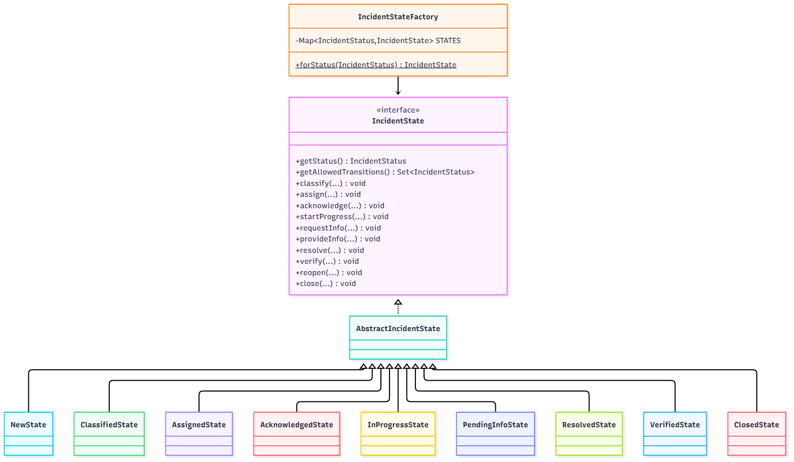
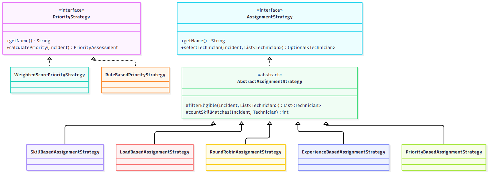
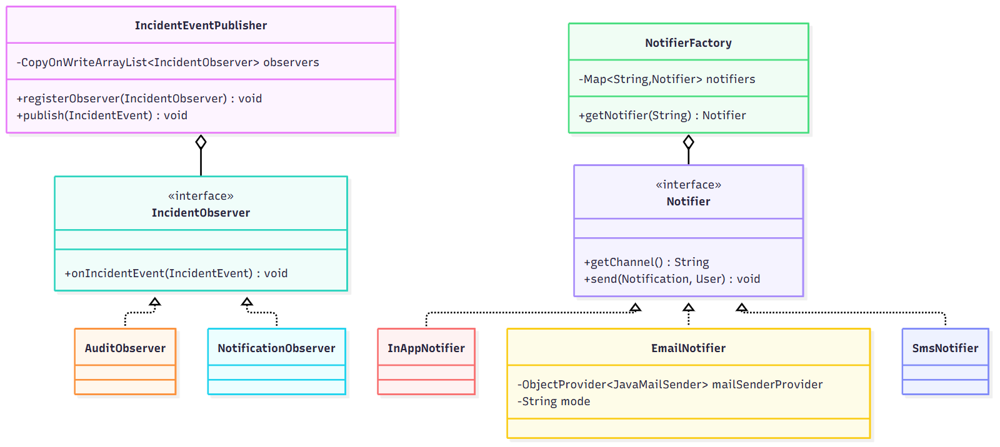
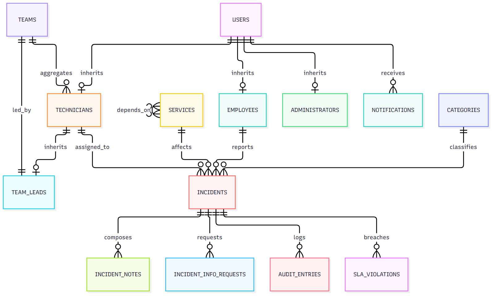

# I-ITSM: Intelligent IT Service Management & Incident Resolution System

**Course:** Object-Oriented Programming (CS F213)  
**Group Number:** 83  
**Team Members:**
- **Vinayak Nath** — `2024B2AD1046H`
- **Anubhav Amarnath Savur** — `2024B3AD0581H`
- **Sai Yuvraj Guntha** — `2024B3AD0540H`

**Repository:** https://github.com/WimpyWeb/iitsm-oop

---

<div class="page-break"></div>

## 1. Problem Analysis

### 1.1 Problem Statement
Manual IT helpdesks suffer from unstructured ticket triage, misrouted assignments, missed SLA response and resolution deadlines, duplicate ticket storms during service outages, and lack of historical auditability. I-ITSM automates incident intake, priority scoring, technician routing, SLA tracking, multi-level escalation, dependency root-cause correlation, and operational analytics using clean object-oriented design.

### 1.2 Stakeholders
| Stakeholder | Code Range | Role in System | Primary Needs |
| --- | --- | --- | --- |
| **Employee** | `E101+` | Incident Reporter | Fast submission, live duplicate/category hints, transparent status timeline, verification & feedback |
| **Technician** | `T101+` | First-Line Support | Skill-aligned queue, clear SLA countdowns, investigation notes, AI resolution hints, workload control |
| **Team Lead** | `T201+` | Escalation & Team Lead | Team oversight, Level-1 escalation alerts, manual queue balancing |
| **System Admin** | `A001` | Platform Operator | Runtime strategy switching, catalog/service/SLA CRUD, user provisioning, Level-2 escalation, audit logs |
| **IT Manager** | `A002` | Service Executive | Level-3 escalation oversight, SLA compliance %, recurring problem & feedback analytics |

### 1.3 Key Challenges
1. **Dynamic Lifecycle Rules**: Preventing illegal shortcuts (such as `NEW -> CLOSED` or editing after `RESOLVED`) without sprawling `if/else` chains.
2. **Configurable Triage & Routing**: Allowing administrators to switch priority formulas and assignment algorithms at runtime without redeploying code.
3. **Duplicate & Outage Storms**: Detecting exact duplicate tickets versus related symptoms during cascading dependency failures (e.g., `Database -> Payment`).
4. **SLA Accountability**: Tracking response and resolution windows separately, warning at 80% elapsed, recording single breaches, and escalating progressively across management tiers.

### 1.4 Solution & Operational Assumptions
I-ITSM implements a layered Spring Boot 3.3 + Java 21 architecture anchored by **State**, **Strategy**, **Observer**, **Factory**, **Adapter**, and **Repository** patterns, paired with an offline **TF-IDF Cosine Similarity** engine, **Service Dependency Graph** correlation, **@Scheduled SLA Monitor**, **Chart.js + HTMX** analytics, and a secured **REST API** with Swagger UI.
- Persistence uses H2 file mode (`./data/iitsm`); only one application process accesses the H2 file at a time.
- Email (`app.notify.email.mode=simulated`) and SMS default to file/log output (`./data/email-notifications.log`, `./data/sms-notifications.log`); live Gmail SMTP activates via environment credentials.
- AI text features default to `LocalTfIdfAiService`; `GeminiAiService` activates only when `GEMINI_API_KEY` is provided and falls back locally on error.
- Priority thresholds (`P1>=60`, `P2>=30`, `P3>=10`) and SLA scale (`app.sla.time-scale=1`) are externalized in `application.yml`.
- Self-registration creates `Employee` accounts only; `Technician`, `TeamLead`, and `Administrator` accounts are admin-managed.

---

## 2. Requirements Specification

### 2.1 Functional Requirements by Role
- **Employee (`ROLE_EMPLOYEE`)**: Self-register (`Employee` only), sign in, submit incidents with live category/service/duplicate suggestions, view own incidents, edit description/impact/urgency/affected users while `status < RESOLVED`, answer `PENDING_INFO` clarification requests, add notes, verify or reopen `RESOLVED` tickets, and submit 1–5 feedback.
- **Technician (`ROLE_TECHNICIAN`)**: View assigned queue & skill-recommended unassigned incidents, toggle availability, claim unassigned tickets, acknowledge (`ASSIGNED -> ACKNOWLEDGED`), start investigation (`IN_PROGRESS`), add investigation notes, request info (`PENDING_INFO`), view AI resolution hints, resolve (`RESOLVED`), decline assignment with reason (triggering automatic exclusion-based reassignment), override priority, and close `VERIFIED` tickets.
- **Team Lead (`TeamLead extends Technician`)**: Inherits all Technician capabilities plus team oversight and Level-1 SLA escalation handling.
- **Administrator (`ROLE_ADMIN`, `SYSTEM_ADMIN` / `IT_MANAGER`)**: Provision accounts, CRUD teams, DB-driven categories, services/dependencies, and SLA policies, switch `PriorityStrategy` and `AssignmentStrategy` at runtime, manually assign/reassign incidents, view immutable global audit logs, inspect `SlaViolation` records, and view analytics/recurring problem dashboards.

### 2.2 Non-Functional & Business Rules
- **Lifecycle Enforcement**: `NEW -> CLASSIFIED -> ASSIGNED -> ACKNOWLEDGED -> IN_PROGRESS <-> PENDING_INFO`; `IN_PROGRESS -> RESOLVED`; `RESOLVED -> VERIFIED` or `RESOLVED -> IN_PROGRESS`; `VERIFIED -> CLOSED`. Reassignment returns `ASSIGNED`/`ACKNOWLEDGED`/`IN_PROGRESS` to `ASSIGNED`. Intake executes `NEW -> CLASSIFIED -> ASSIGNED` synchronously, placing tickets in an unassigned `PriorityQueue` (`CLASSIFIED`) if all technicians are unavailable or at `maxLoad`.
- **Exception Hierarchy**: `ITSMException` base class with 13 typed subclasses (`InvalidLoginException`, `UnauthorizedException`, `IncidentNotFoundException`, `InvalidStateTransitionException`, `ServiceNotFoundException`, `MissingSlaException`, `TechnicianUnavailableException`, `WorkloadExceededException`, `DuplicateIncidentException`, `InvalidInputException`, `InvalidIncidentException`, `NotificationDeliveryException`, `PersistenceFailureException`) handled via `@ControllerAdvice` (`GlobalExceptionHandler`) returning friendly HTML error pages or JSON `ApiErrorResponse` without leaking stack traces.
- **Security**: BCrypt hashing (min 8-char password), Bean Validation, CSRF enabled on Web UI (HTMX sends `_csrf` header via `htmx:configRequest`), stateless HTTP Basic on `/api/**`, URL + `@PreAuthorize` role enforcement, record ownership enforcement, Thymeleaf XSS escaping, parameterized JPA SQLi defense, and H2 console restricted to `dev` profile.

### 2.3 Priority Algorithms & Mathematical Rationale
**Weighted Score Strategy (`WeightedScorePriorityStrategy`, default):**
```text
score = impact × urgency × businessCriticality × usersFactor
```
- `usersFactor`: `1.0` (`< 10` affected users), `1.2` (`10–99` affected users), `1.5` (`>= 100` affected users).
- Externalized thresholds: `P1 >= 60` (**Critical**), `P2 >= 30` (**High**), `P3 >= 10` (**Medium**), else `P4` (**Low**).
- **Rationale**: Multiplicative scoring couples technical severity (`impact * urgency`) with enterprise exposure (`businessCriticality * usersFactor`), ensuring business-critical services like `Payment` (`criticality = 5`) reach `P1` rapidly when broad user populations are impacted.

**Rule-Based Strategy (`RuleBasedPriorityStrategy`):**
- Directly promotes to `P1` when `(businessCriticality == 5 && impact >= 4)`, `(category == Security && impact >= 4)`, or `(affectedUsersCount >= 100 && urgency >= 4)`; promotes `impact + urgency >= 7` or high-criticality moderate outages to `P2`.
- **Rationale**: Captures non-linear compliance, outage, and security emergencies where a low initial urgency estimate would otherwise delay critical response.

### 2.4 SLA Tracking & Multi-Level Escalation
- Default SLA policies: `P1` `5m / 30m`, `P2` `15m / 2h`, `P3` `1h / 8h`, `P4` `4h / 24h`; per-service overrides (`ServiceEntity.overrideResponseMins` / `overrideResolutionMins`) take precedence over defaults, and missing policies throw `MissingSlaException`.
- `app.sla.time-scale` shrinks all SLA durations `N×` for live demonstrations.
- `@Scheduled` `SlaEscalationMonitor` flags `AT_RISK` once at `>= 80%` elapsed, records unique `SlaViolation` rows (`RESPONSE` / `RESOLUTION`) once past deadline (`BREACHED`), and escalates unacknowledged tickets meeting `escalation.min-priority` per response interval across `0 (Technician) -> 1 (TeamLead) -> 2 (SYSTEM_ADMIN) -> 3 (IT_MANAGER)`.

---

<div class="page-break"></div>

## 3. System Architecture

I-ITSM enforces strict unidirectional layering (`controller -> service -> domain -> repository`) with zero web or servlet imports inside `domain/`, `spring.jpa.open-in-view=false`, and `EntityGraphType.LOAD` hydration.



### 3.1 Core OOP Concepts & Design Patterns
| Principle / Pattern | Exact Implementation Classes | Architectural Purpose |
| --- | --- | --- |
| **Encapsulation** | Private fields, validated setters (`User`, `Technician`, `Incident`, `ServiceEntity`), `Collections.unmodifiable*` collection views, immutable `AuditEntry` (no setters), `transitionStatus(next, stateProof)` | Prevents invalid mutations (e.g., editing post-`RESOLVED` throws `InvalidIncidentException`; illegal status jumps are impossible outside `IncidentState`). |
| **Inheritance (`is-a`)** | `abstract User -> Employee`, `Technician -> TeamLead`, `Administrator` (`InheritanceType.JOINED`); `ITSMException` hierarchy | Restricts inheritance solely to true `is-a` specialization with polymorphic `getDisplayIdentity()`. |
| **Composition & Aggregation** | `Incident` composes `SlaInfo`, `Resolution`, `Closure`, `Feedback`, `InvestigationNote`, `InfoRequest`; `Team` aggregates `Technician`; `Technician` aggregates `serviceExperienceCounts` | Models lifecycle-owned child entities via composition and independent team membership via aggregation. |
| **State Pattern** | `IncidentState`, `AbstractIncidentState`, `NewState`..`ClosedState` (9 states), `IncidentStateFactory` (`EnumMap`) | Replaces brittle `if/switch` lifecycle logic with polymorphic state handlers. |
| **Strategy Pattern** | `PriorityStrategy` (2), `AssignmentStrategy` (`SkillBased`, `LoadBased`, `RoundRobin`, `ExperienceBased`, `PriorityBased`), `AbstractAssignmentStrategy` | Allows Admins to switch priority and routing algorithms at runtime, persisted in `AppSetting`. |
| **Observer Pattern** | `IncidentEventPublisher`, `IncidentObserver`, `AuditObserver`, `NotificationObserver`, `IncidentEvent` | Decouples core transactions from immutable audit recording and channel-aware alerting. |
| **Factory Pattern** | `UserFactory`, `IncidentFactory`, `NotificationFactory`, `NotifierFactory`, `IncidentStateFactory` | Centralizes formatted IDs (`E101+`, `INC1001+`) and `ConcurrentHashMap` channel lookup. |
| **Adapter Pattern** | `Notifier` (`InAppNotifier`, `EmailNotifier` over `JavaMailSender`, `SmsNotifier`), `AiTextService` (`LocalTfIdfAiService`, `GeminiAiService` over `RestClient`) | Isolates external SMTP and Gemini APIs behind swappable interfaces with fallback. |
| **Collections** | `EnumMap` (`IncidentStateFactory`), `PriorityQueue` (`IncidentService.getUnassignedQueue`), `ConcurrentHashMap` (`NotifierFactory`), `ConcurrentLinkedDeque` (Observers) | Matches data structure complexity and thread safety to exact access patterns. |

---

<div class="page-break"></div>

## 4. UML Diagrams

### 4.1 Use-Case Diagram
Actors (`Employee`, `Technician`, `TeamLead`, `Administrator`) interact with role-scoped capabilities across intake, triage, investigation, verification, catalog administration, and analytics.



<div class="page-break"></div>

### 4.2 Domain Hierarchy, Aggregation & Composition
Shows `User` inheritance (`JOINED`), `Team` aggregation over `Technician` and `TeamLead`, and `Incident` composition of `SlaInfo` and `Resolution`.



<div class="page-break"></div>

### 4.3 State Pattern
All 9 concrete lifecycle states extend `AbstractIncidentState` and are resolved in `O(1)` from `IncidentStateFactory`'s `EnumMap`.



<div class="page-break"></div>

### 4.4 Strategy Pattern
Runtime-swappable `PriorityStrategy` and `AssignmentStrategy` hierarchies, sharing candidate filtering and skill matching via `AbstractAssignmentStrategy`.



### 4.5 Observer, Factory & Notifier Adapter
Event-driven `IncidentEventPublisher` dispatches to `AuditObserver` and `NotificationObserver`, which routes alerts through `NotifierFactory` adapters with automatic fallback to `InAppNotifier`.



---

## 5. Technology Stack

### 5.1 Why Java 21?
Java 21 provides strict compile-time type safety, explicit interfaces, abstract base classes, `EnumMap`, immutable `record` DTOs, and pattern-matching `switch` expressions—making every OOP principle and design pattern transparent, verifiable, and maintainable.

### 5.2 Why Thymeleaf + HTMX + Pico.css?
Thymeleaf provides secure server-side HTML rendering with automatic XSS escaping; HTMX adds reactive partial updates (15s notification bell polling, live AI category/service/duplicate hints while typing, live report KPI refresh) without writing JavaScript build pipelines; Pico.css provides clean responsive styling with minimal CSS overhead.

### 5.3 Why Spring Boot 3.3?
Spring Boot 3.3 (`3.3.5`) integrates Dependency Injection, `@Transactional` ACID boundaries, Spring Data JPA `Specification` search, Spring Security 6 (BCrypt, CSRF, HTTP Basic), Bean Validation, `@Scheduled` background monitoring, `JavaMailSender`, and `springdoc-openapi` Swagger UI in one cohesive executable JAR.

### 5.4 Why H2 (File Mode `./data/iitsm`)?
H2 persistent file mode eliminates external DB installation friction during development and grading while surviving restarts on disk and using standard JPA/SQL (`@Entity`, `@Table`, `@Index`), enabling an instant swap to PostgreSQL in production.

### 5.5 Why Layered Architecture (`controller -> service -> domain -> repository`)?
Strict unidirectional layering separates HTTP/CSRF concerns (`controller`), transaction/pipeline orchestration (`service`), pure OOP business rules (`domain` with zero web imports), and data access (`repository`), ensuring every layer is independently testable.

### 5.6 Alternatives Considered
- **React/Angular SPA vs. Thymeleaf + HTMX**: Rejected SPAs to avoid Node/npm build tooling, duplicated validation rules, and CORS complexity.
- **NoSQL (MongoDB) vs. Relational JPA**: Rejected MongoDB because `User` `JOINED` inheritance, SLA foreign keys, unique violation constraints, and combinable `Specification` queries benefit from relational ACID guarantees.
- **Lombok vs. Explicit Java**: Rejected Lombok so private fields, validated setters, unmodifiable collection wrappers, and immutable `AuditEntry` constructors remain explicit for OOP grading.

### 5.7 Pros & Cons of Chosen Stack
- **Pros**: Single-command startup (`./mvnw spring-boot:run`), compile-time OOP contracts, zero JS bundler step, built-in CSRF/BCrypt/SQLi/XSS defense, and fast in-memory CI testing.
- **Cons**: H2 file mode permits only one JVM process at a time; synchronous observer email calls can block HTTP threads under high SMTP latency; `open-in-view=false` requires explicit `@EntityGraph` / DTO projection discipline.

### 5.8 How Java Supports OOP in I-ITSM
Java enforces encapsulation (`private` fields, validated setters, no setters on `AuditEntry`), true `is-a` specialization (`abstract User` subtypes), interface-driven polymorphism (`IncidentState`, `PriorityStrategy`, `AssignmentStrategy`, `IncidentObserver`, `Notifier`, `AiTextService`), and type-safe collections (`EnumMap`, `PriorityQueue`, `ConcurrentHashMap`).

### 5.9 Production Scaling Plan to Many Concurrent Users
1. **Database Migration**: Switch H2 JDBC URL/driver to managed **PostgreSQL** with Flyway migrations, retaining existing `incidents` indexes (`status`, `priority`, `service_id`, `technician_id`, `created_at`).
2. **Distributed Caching**: Add **Redis** (`@Cacheable`) for read-heavy `Category`, `ServiceEntity`, `SlaPolicy`, and `AppSetting` catalogs plus read replicas for `ReportService`.
3. **Async Event Messaging**: Replace synchronous `EmailNotifier`/`SmsNotifier` calls in `NotificationObserver` with **Kafka / RabbitMQ** queues so external mail/SMS latency never stalls request threads.
4. **Stateless Horizontal Scaling**: Services are already stateless (`open-in-view=false`, stateless `/api/**`); externalize web sessions to **Spring Session + Redis** behind a load balancer and extract `Notification` and `AI` adapters as standalone worker microservices.

---

<div class="page-break"></div>

## 6. Database Design



### 6.1 Schema & Relationships
- **Users (`JOINED` Inheritance)**: Base `users` table (`id`, `user_code`, `username`, `email`, `full_name`, `password_hash`, `role`, `active`, `created_at`) joined with `employees` (`department`, `job_title`), `technicians` (`experience_years`, `available`, `max_load`, `current_load`, `team_id` + `technician_skills` + `technician_service_exp`), `team_leads`, and `administrators` (`admin_level`).
- **Teams**: `teams` (`id`, `name`, `specialty_category`, `team_lead_id` FK -> `team_leads`), aggregated by `technicians.team_id`.
- **Catalog & Dependencies**: `categories` (`id`, `name` + `category_keywords`), `services` (`id`, `name`, `business_criticality`, `override_response_mins`, `override_resolution_mins` + `service_keywords`), self-referencing join `service_dependencies` (`service_id`, `depends_on_id`), `sla_policies` (`priority`, `response_mins`, `resolution_mins`), and `app_settings` (`setting_key`, `setting_value`).
- **Incidents & Composed Records**: `incidents` (PK `id VARCHAR(20)` `INC1001..`, FKs `reporter_id`, `category_id`, `service_id`, `technician_id`, embedded `SlaInfo`, `Resolution`, `Closure`, `Feedback`), plus `incident_notes`, `incident_info_requests`, `incident_related`, and `incident_declined_techs`.
- **Audit, Violations & Alerts**: `audit_entries` (`updatable = false` immutable log), `sla_violations` (unique constraint `uk_sla_violation_incident_type` on `(incident_id, type)`), and `notifications`.
- **Performance Indexes**: `idx_incident_status`, `idx_incident_priority`, `idx_incident_service`, `idx_incident_technician`, `idx_incident_created`, `idx_audit_incident`, `idx_audit_timestamp`, and `idx_notif_recipient`.

### 6.2 Sample Seed Rows
| Table | Representative Sample Row |
| --- | --- |
| `users` / `employees` | `user_code='E101'`, `username='emp1'`, `role='EMPLOYEE'`, `department='Finance'` |
| `users` / `technicians` | `user_code='T101'`, `username='tech1'`, `skills=['payment','checkout','application','api']`, `max_load=6` |
| `services` | `name='Payment'`, `business_criticality=5`, `depends_on=['Database','Network','Authentication']` |
| `sla_policies` | `priority='P1'`, `response_mins=5`, `resolution_mins=30` |
| `incidents` | `id='INC1001'`, `reporter='E101'`, `service='Payment'`, `priority='P1'`, `priority_score=187.5`, `status='ASSIGNED'` |
| `audit_entries` | `actor='Employee E101'`, `action='CREATED'`, `incident_id='INC1001'`, `new_state='NEW'` |

---

<div class="page-break"></div>

## 7. Testing

All **61 automated JUnit 5 / Mockito / MockMvc tests** across **12 test classes** verify domain invariants, algorithms, persistence, security, REST/Swagger endpoints, and failure handling.

### 7.1 State Lifecycle & Priority Unit Tests (TC01–TC10)

| ID | Category | Input / Scenario | Expected Outcome | Exact JUnit Class & Method |
| --- | --- | --- | --- | --- |
| TC01 | Lifecycle (State) | Walk `NEW -> CLASSIFIED -> ASSIGNED -> ACKNOWLEDGED -> IN_PROGRESS -> PENDING_INFO -> IN_PROGRESS -> RESOLVED -> VERIFIED -> CLOSED` | Statuses advance, load increments/releases, `serviceExperience` increments | `IncidentStateTest.fullLifecycleFromNewToClosed` |
| TC02 | Illegal Transition | Call `close()` on a `NEW` incident | Throws `InvalidStateTransitionException` | `IncidentStateTest.newToClosedThrowsInvalidStateTransition` |
| TC03 | Illegal Transition | Call `close()` on `RESOLVED` without `VERIFIED` | Throws `InvalidStateTransitionException` | `IncidentStateTest.resolvedToClosedWithoutVerifyThrowsInvalidStateTransition` |
| TC04 | Reassignment | Reassign `IN_PROGRESS` incident from `T101` to `T102` | Moves to `ASSIGNED`, releases `T101`, increments `T102` | `IncidentStateTest.reassignTransfersWorkloadBetweenTechnicians` |
| TC05 | Decline | Assigned technician declines with reason | Returns to `CLASSIFIED`, clears assignee, records `T101` | `IncidentStateTest.declineAssignmentReturnsToClassifiedAndRecordsDecliner` |
| TC06 | Reopen | Reporter rejects fix on `RESOLVED` incident | Moves to `IN_PROGRESS`, clears `resolvedAt`, restores load | `IncidentStateTest.reopenFromResolvedMovesBackToInProgress` |
| TC07 | Workload Boundary | Assign technician with `currentLoad == maxLoad` | Throws `WorkloadExceededException`; stays `CLASSIFIED` | `IncidentStateTest.assigningOverMaxLoadThrowsWorkloadExceededException` |
| TC08 | Priority Formula | Same service/severity with 5, 50, 100 affected users | Scores `36.0`, `43.2`, `54.0` (`1.0`, `1.2`, `1.5` factors) | `PriorityStrategyTest.weightedScoreCalculatesExactFormulaAcrossUserTiers` |
| TC09 | Boundary Thresholds | Inputs hitting `60`, `54`, `30`, `27`, `10`, `9` | Classified `P1`, `P2`, `P2`, `P3`, `P3`, `P4` | `PriorityStrategyTest.weightedScoreBoundaryThresholdsClassifyCorrectly` |
| TC10 | Rule-Based Priority | Criticality 5 & impact 4; Security & impact 4 | Promoted to `P1` under `RuleBasedPriorityStrategy` | `PriorityStrategyTest.ruleBasedPromotesCriticality5WithImpact4ToP1` |

### 7.2 Assignment, Encapsulation, TF-IDF & Observer Unit Tests (TC11–TC18)

| ID | Category | Input / Scenario | Expected Outcome | Exact JUnit Class & Method |
| --- | --- | --- | --- | --- |
| TC11 | Skill Assignment | Pool with network vs payment skills on Payment ticket | Selects `T102` with highest skill alignment | `AssignmentStrategyTest.skillBasedSelectsTechnicianWithHighestSkillAlignment` |
| TC12 | Load / RR Assignment | 3 eligible technicians with differing loads | Load picks lowest ratio (`T101`); RR cycles `T101 -> T102 -> T201 -> T101` | `AssignmentStrategyTest.loadBasedSelectsLowestWorkloadRatioTechnician` |
| TC13 | Priority / Exp Assignment | `P1` vs `P4` tickets; service experience history | `P1` routes to `T201`; `P4` to `T101`; exp picks `T102` | `AssignmentStrategyTest.priorityBasedRoutesP1ToSeniorAndP4ToLowLoadJunior` |
| TC14 | Encapsulation | Reflect `AuditEntry` setters; mutate collection getters | Zero `set*` methods; `UnsupportedOperationException` on mutations | `DomainModelEncapsulationTest.auditEntryExposesNoSetters` |
| TC15 | Edit Guard | Edit incident after `RESOLVED` | Throws `InvalidIncidentException` | `DomainModelEncapsulationTest.editingResolvedIncidentThrowsInvalidIncidentException` |
| TC16 | Course Similarity | `"Payment application unavailable"`, `"Payment transaction failing"`, `"Unable to make payment"` | All 3 pairwise similarities `>= 0.2` and `< 0.8` | `TfIdfSimilarityEngineTest.coursePaymentExamplesAreAllFlaggedRelated` |
| TC17 | Duplicate vs Unrelated | Near-identical vs office printer text | Near-identical `>= 0.8`; unrelated `< 0.2` | `TfIdfSimilarityEngineTest.nearIdenticalDescriptionsExceedExactDuplicateThreshold` |
| TC18 | Observer Routing | Publish `ASSIGNED` (P3), `SLA_APPROACHING` (P1), `SLA_VIOLATED` | P3 -> `IN_APP`; P1/SLA -> `IN_APP`, `EMAIL`, `SMS` to exact targets | `ObserverPatternTest.notificationObserverRoutesP3InAppOnlyAndP1ToMultiChannel` |

### 7.3 Service Integration, Security, SLA, Outage & REST Tests (TC19–TC31)

| ID | Category | Input / Scenario | Expected Outcome | Exact JUnit Class & Method |
| --- | --- | --- | --- | --- |
| TC19 | Sync Create Pipeline | Create P1 Payment incident via `IncidentService` | Runs `NEW -> CLASSIFIED -> ASSIGNED`, 3 audits, multi-channel alerts | `IncidentServiceIntegrationTest.createPipelineRunsSynchronouslyAndAuditsAndNotifiesAllSteps` |
| TC20 | Duplicate Exception | Same reporter submits identical Payment outage `< 10m` | Throws `DuplicateIncidentException`; different symptoms link related | `IncidentServiceIntegrationTest.exactDuplicateThrowsExceptionAndRelatedIncidentsAreLinked` |
| TC21 | Unassigned Queue | All technicians at `maxLoad`; submit `P4` then `P1` | Stay `CLASSIFIED`; `PriorityQueue` orders `P1` before `P4` | `IncidentServiceIntegrationTest.unassignedQueueOrdersByPriorityWhenAllTechniciansAtMaxLoad` |
| TC22 | Decline & Auto-Reassign | `T101` declines assignment | Automatically reassigns `T102` excluding `T101` | `IncidentServiceIntegrationTest.technicianDeclineReassignsExcludingDecliner` |
| TC23 | SLA Override & Missing | Service override `2m/10m`; delete `P3` policy | Uses `2m/10m`; missing policy throws `MissingSlaException` | `IncidentServiceIntegrationTest.serviceSlaOverrideAndMissingSlaAreEnforced` |
| TC24 | Runtime Strategy Swap | Switch to `RULE_BASED` + `LOAD_BASED` | Subsequent incident applies new priority & load routing | `IncidentServiceIntegrationTest.runtimeStrategySwitchUpdatesPriorityAndAssignmentSelection` |
| TC25 | Email SMTP Fallback | Set `EmailNotifier` mode `smtp` with no mail server | Catches `NotificationDeliveryException`, falls back to `IN_APP`, audits | `IncidentServiceIntegrationTest.emailSmtpFailureFallsBackToInAppAndAuditsError` |
| TC26 | Web Smoke Lifecycle | Real login -> report -> acknowledge -> start -> resolve -> verify -> feedback -> close | Full workflow succeeds `200/302`; audit timeline rendered | `WebFlowAndSecurityTest.smokeTestFullLifecycleThroughWebControllersAndViews` |
| TC27 | Security & CSRF | Employee hits `/admin/dashboard`, peer incident, or omits CSRF | Returns `403 Forbidden`; `/register` creates `EMPLOYEE` only | `WebFlowAndSecurityTest.employeeBlockedFromAdminAndOtherEmployeesIncident` |
| TC28 | SLA Monitor & Escalation | Advance clock to 83%, 5m+, 10m+, 15m+ on unacknowledged `P1` | `AT_RISK`, 1 `SlaViolation`, escalates `T201 -> A001 -> A002` | `PhaseDIntelligenceSlaAndApiTest.slaApproachingWarningBreachSingleRecordAndMultiLevelEscalation` |
| TC29 | Outage & Root Cause | 3 open `Database` incidents in 1h, then `Payment` incident | Flags `outageFlagged=true`; sets `"Possible root cause: Database"` | `PhaseDIntelligenceSlaAndApiTest.outageCorrelationAndDependencyRootCauseFlagged` |
| TC30 | AI, Reports & REST | Past fix match, Gemini fallback, 7d report, `/api/v1/**` + Swagger | `201/200`, `401` anon, `403` wrong role, `4.0` avg feedback | `PhaseDIntelligenceSlaAndApiTest.restApiBasicAuthRoleChecksTransitionsSearchReportsAndSwaggerWork` |
| TC31 | Cold DB Seed | `dataSeeder.seedIfEmpty()` on empty H2 DB (twice) | Seeds 9 cats, 8 svcs, 4 SLAs, 12 users, 2 teams, 30 incidents; idempotent | `DataSeederTest.seedsCleanEmptyDatabaseAndIsIdempotent` |

### 7.4 Audit & Explicit Exception Handling Tests (TC32–TC41)

| ID | Category | Input / Scenario | Expected Outcome | Exact JUnit Class & Method |
| --- | --- | --- | --- | --- |
| TC32 | Role UIs & Catalog CRUD | Login as `emp1`, `tech1`, `lead1`, `sysadmin`, `itmanager`; edit catalog | Distinct `topbar-*` UIs, restart safe, category/service updates work | `AuditVerificationTest.seededRolesAllLoginAndSeeDistinctRoleUisAndDataPersistsAcrossReseed` |
| TC33 | Illegal Moves (UI + API) | `ASSIGNED -> CLOSED` on UI & REST; `NEW -> CLOSED` domain | `409 Conflict`, friendly error message, zero stack traces | `AuditVerificationTest.illegalTransitionsRejectedInBothWebUiAndRestApiWithFriendlyMessage` |
| TC34 | All 12 Exceptions | Trigger every `ITSMException` subclass incl. DB & network | Exact HTTP status (`400..502`), friendly message, zero stack traces | `AuditVerificationTest.allTwelveExceptionsTriggeredWithFriendlyMessagesAndNoStackTraces` |
| TC35 | Security Hardening & XSS | Wrong password, `<script>alert('xss')</script>`, BCrypt DB check | Rejected `302/401`, XSS HTML-escaped, `$2a$/$2b$` hashes verified | `AuditVerificationTest.securityWrongPasswordXssEscapingInvalidInputAndBcryptHashing` |
| TC36 | Accelerated 3m Escalation & DB-Exact Reports | `slaTimeScale=10` (91s total `0->3`); compare `ReportService` vs DB | All 4 escalation levels in `91s < 180s`; report totals match DB | `AuditVerificationTest.slaDefaultsAndAcceleratedTimeScaleEscalateAllFourLevelsWithinThreeMinutes` |
| TC37 | InvalidLoginException | Wrong credentials passed to `userService.authenticate` & `GlobalExceptionHandler` | Throws `InvalidLoginException` (`401`), friendly message, zero stack trace | `ExceptionHandlingTest.invalidLoginExceptionReturns401WithFriendlyMessage` |
| TC38 | IncidentNotFoundException | Request nonexistent `INC9999` via REST `/api/v1/incidents/INC9999` & Web `/incidents/INC9999` | HTTP `404`, `"Incident not found: INC9999"`, zero stack trace | `ExceptionHandlingTest.incidentNotFoundExceptionReturns404WithFriendlyMessage` |
| TC39 | ServiceNotFoundException | `POST /api/v1/incidents` with nonexistent `serviceId: 999999` | HTTP `404`, `"Service not found: 999999"`, `ServiceNotFoundException` | `ExceptionHandlingTest.serviceNotFoundExceptionReturns404WithFriendlyMessage` |
| TC40 | TechnicianUnavailableException | Assign `T103` (`available=false`) via REST & Web UI | HTTP `409`, `"Technician T103 is unavailable."`, zero stack trace | `ExceptionHandlingTest.technicianUnavailableExceptionReturns409WithFriendlyMessage` |
| TC41 | PersistenceFailureException (Mockito) | Mock `IncidentRepository.save` to throw `DataRetrievalFailureException` | Wraps into `PersistenceFailureException` (`500`), friendly error without SQL leak | `ExceptionHandlingTest.persistenceFailureExceptionWrapsMockedDataAccessExceptionWith500FriendlyMessage` |

---

## 8. Project Demonstration

### 8.1 Launch Command & Seeded Credentials
```cmd
rmdir /s /q data 2>nul
set APP_SLA_TIME_SCALE=60
set APP_SLA_MONITOR_INTERVAL_SECONDS=5
.\mvnw.cmd spring-boot:run
```
All seeded accounts (`emp1`..`emp4`, `tech1`..`tech4`, `lead1`, `lead2`, `sysadmin`, `itmanager`) use password **`Password123!`**.

### 8.2 18-Minute Presentation Timeline (Group 83)
| Slot | Speaker | Modules Explained | Live Demo Action |
| --- | --- | --- | --- |
| `0:00–6:00` | **Vinayak Nath** (`2024B2AD1046H`) | Problem Analysis, `User` Inheritance, `IncidentState`, `IncidentService`, `DataSeeder` | Introduce Group 83, open `/login` & `INC1001`, run **Workflow 1** |
| `6:00–12:00` | **Anubhav Amarnath Savur** (`2024B3AD0581H`) | `PriorityStrategy` / `AssignmentStrategy`, `TfIdfSimilarityEngine`, `SlaEscalationMonitor`, `Observer` & `Notifier` | Run **Workflow 2** (Accelerated SLA Escalation & Resolution) + check notification logs |
| `12:00–18:00` | **Sai Yuvraj Guntha** (`2024B3AD0540H`) | `OutageCorrelator`, `ReportService`, `SecurityConfig`, `Specification` Search, REST/Swagger & Tests | Run **Workflow 3** (Duplicates + Outage + `/reports`), Swagger `/api/v1/reports/summary`, `/admin/audit` |

### 8.3 Demonstration Workflows (Each ≤ 5 Minutes)
- **Workflow 1 — Report -> Prioritize -> Assign -> Notify**: Sign in as `emp1` -> click **Report Incident** -> select `Payment`, leave Category `Auto-detect`, type *"Payment gateway checkout throwing HTTP 502 errors for customers"* -> confirm HTMX renders **AI Suggested Category: Application | Suggested Service: Payment** and related `INC1001` -> set Impact `5`, Urgency `5`, Users `120` -> submit -> verify `INC1031` is `P1 Critical` (`187.5`), `ASSIGNED` to `T101`, audited (`CREATED -> CLASSIFIED -> ASSIGNED`), and logged to Bell + `./data/email-notifications.log`.
- **Workflow 2 — Investigate -> SLA Warning & Escalation -> Resolve -> Verify -> Close**: Wait ~15s under `APP_SLA_TIME_SCALE=60` -> `INC1031` warns at 80% (`AT_RISK`), breaches (`BREACHED`), records `SlaViolation`, and escalates `Level 1 (T201) -> Level 2 (A001) -> Level 3 (A002)` -> sign in as `sysadmin` to verify `/admin/sla-violations` & `/admin/audit` -> sign in as `tech1` -> **Acknowledge** -> **Start Investigation** -> check **Suggested Resolution** -> **Mark Resolved** -> sign in as `emp1` -> **Confirm Fix (Verify)** & submit `5/5` feedback -> sign in as `tech1` -> **Close Verified Incident** (`CLOSED`).
- **Workflow 3 — Duplicate Blocking, Outage Correlation & Live Analytics**: As `emp1`, resubmit `INC1001`'s exact description on `Payment` -> blocked with `DuplicateIncidentException` warning; as `emp2`, submit `"Payment transaction failing"` and `"Unable to make payment"` -> linked as related; submit 3 distinct `Database` incidents (`outageFlagged = true` on the 3rd), then submit a `Payment` ticket -> displays **`Possible root cause: Database`**; sign in as `sysadmin` -> inspect `/reports` (Chart.js + 7-day recurring problems) and `/swagger-ui.html`.

---

## 9. Evaluation & Limitations

- **Strengths**: Clean separation of OOP design patterns from web and persistence layers; zero-JS-build reactive HTMX/Thymeleaf UI with distinct role portals; offline TF-IDF intelligence plus optional Gemini REST adapter; full immutable auditability and comprehensive automated test coverage.
- **Limitations**:
  1. SMS notifications and default email delivery (`simulated` mode) log to local files unless configured with live SMTP/gateway credentials.
  2. `H2` file persistence supports only one running JVM instance against `./data/iitsm`; multi-node scaling requires switching to PostgreSQL.
  3. Local TF-IDF category/resolution suggestions rely on keyword and historical text overlap when `GEMINI_API_KEY` is unset.

---

## 10. Team Contributions (Group 83)

| Member | ID | Role | Responsibility | Modules Owned |
| --- | --- | --- | --- | --- |
| **Vinayak Nath** | `2024B2AD1046H` | Domain, State & Core Services Lead | Core OOP model, `User` hierarchy, `IncidentState` lifecycle, `AuditEntry`, `ITSMException`, `IncidentService`, `DataSeeder`, Docker/CI | `domain.model.*`, `domain.enums.*`, `domain.state.*`, `domain.factory.*`, `exception.*`, `service.IncidentService`, `config.DataSeeder`, `Dockerfile`, `.github/workflows/ci.yml` |
| **Anubhav Amarnath Savur** | `2024B3AD0581H` | Intelligence, SLA & Notifications Lead | `PriorityStrategy` & `AssignmentStrategy`, `TfIdfSimilarityEngine`, `KeywordClassifier`, `AiTextService`, `OutageCorrelator`, `SlaEscalationMonitor`, `Observer` + `Notifier` adapters | `domain.strategy.*`, `domain.observer.*`, `intelligence.*`, `notification.*`, `service.SlaEscalationMonitor`, `service.NotificationService`, `service.AuditService` |
| **Sai Yuvraj Guntha** | `2024B3AD0540H` | Persistence, Security, Web UI & Analytics Lead | JPA Repositories & `Specification` search, `SecurityConfig`, Thymeleaf + HTMX + Pico.css views, `ReportService` (Chart.js), `/api/v1` REST + Swagger, Test suites & Docs | `repository.*`, `config.SecurityConfig`, `config.OpenApiConfig`, `controller.*`, `service.UserService`, `service.AdminCatalogService`, `service.ReportService`, `templates/**`, `src/test/**`, `docs/*` |
